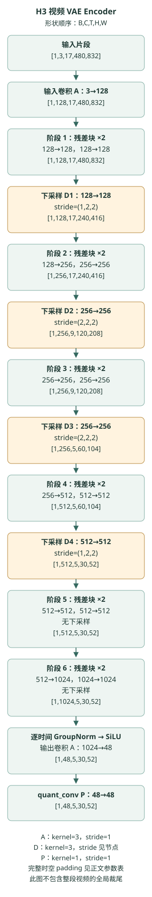
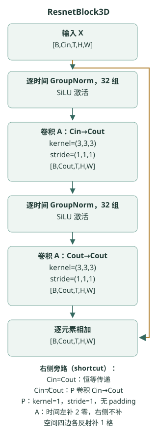

{
  "title": "MiniMax H3 FL2VA：从首尾帧到音视频联合生成",
  "description": "沿着一条具体样本，拆解 MiniMax H3 FL2VA 的双路径条件编码、token 尺寸、联合注意力、AdaLN、SwiGLU 与双调度采样。",
  "summary": "从 124 帧的具体维度出发，追踪首尾帧、音频和视频如何进入同一个 Transformer，再还原为两种 latent 的更新量。",
  "date": "2026-10-28T09:30:00+00:00",
  "lastmod": "2026-10-28T13:22:32+00:00",
  "slug": "minimax-h3-fl2va",
  "categories": ["前沿"],
  "tags": ["MiniMax H3", "音视频生成", "DiT", "Flow Matching"],
  "draft": false,
  "math": true
}

给定一张“人拿着杯子”的首帧、一张“杯子放在桌上”的尾帧，再加一句“他放下杯子，说了一句‘好了’，伴随杯子碰到桌面的声音”，模型需要同时生成动作、说话声与碰撞声，并安排它们发生的时间。

MiniMax H3 的 FL2VA 模式提供了这样一条生成路径。本文沿着**输入条件 → latent → token → 共享 Transformer → 两种更新量 → 迭代解码**展开。重点不是罗列模块名，而是把每一步的形状、计算顺序和条件作用讲清楚。

**阅读范围。** 本文是模型卡与公开推理代码的结构阅读笔记，不将它们称作已经核实的论文实验结论。任务定义参考 [MiniMax 官方模型卡](https://huggingface.co/MiniMaxAI/MiniMax-H3#model-variants-and-input-specifications)；具体计算以 DiffSynth-Studio 提交 [e5a44c4](https://github.com/modelscope/DiffSynth-Studio/tree/e5a44c42776978457b61d51d595a1f6746c3d87a) 为准，核查日期为 2026 年 10 月 28 日。以下数值是该实现的配置与形状推导，不是性能测量，也不代表所有 H3 变体。

## 1. FL2VA 的输入与输出

FL2VA 表示由首尾帧条件生成音视频。官方模型卡中的 H3-Base-FL2VA 支持零张、一张或两张输入图像：

| 已知条件 | 对应任务 |
|---|---|
| 文字 | 纯文字生成音视频 |
| 文字＋首帧 | 从给定画面开始 |
| 文字＋尾帧 | 向给定画面结束 |
| 文字＋首尾帧 | 生成连接两个画面的过程 |

“从给定画面开始”描述的是条件任务；是否达到像素级一致，需要另行判断，不能仅从任务名称推出。后文会回到这一点。

生成并不直接发生在像素和音频采样点上。两个 VAE 分别定义视频与音频的压缩表示，也就是 latent。模型先生成 latent，再由各自的解码器还原：

~~~text
文字、可选首尾帧 → 上下文编码器 → 上下文特征
          首尾帧 → 视频 VAE    → 关键帧条件 latent

上下文 + 关键帧条件 + 音频噪声 + 视频噪声
                     ↓
             共享 Transformer
                     ↓
          音频更新量 / 视频更新量
                     ↓
          分别更新 latent，反复迭代
                     ↓
          音频 VAE / 视频 VAE 解码
                     ↓
               带声音的视频
~~~

统一主干让两种待生成内容在采样过程中交换信息。这为声音与动作的配合提供了计算途径，但架构本身不保证每个样本都能精确同步。

## 2. 首尾帧为什么需要两条编码路径？

首尾帧既进入上下文编码器，也进入视频 VAE。两条路径的结果不能互相替代。

**上下文路径**把文字与图像一起处理，输出供主干读取的上下文特征。代码把组件命名为 text_encoder，但传入关键帧时，PromptEmbedder 也会传递图像张量与网格信息。因此不能把这里的上下文简单理解成纯文字 embedding。

**VAE 路径**把每张关键帧编码到生成所用的视觉 latent 空间，再切成条件 token。这些 token 带有首帧或尾帧对应的位置坐标，进入统一序列。

可以将两者的分工理解为：一条帮助解释“画面内容与指令的关系”，另一条提供“生成空间里的画面表示”。这是对计算路径的解释，不是将两种能力严格分离的实验结论。相关实现见 [PromptEmbedder 与 KeyframeEncoder](https://github.com/modelscope/DiffSynth-Studio/blob/e5a44c42776978457b61d51d595a1f6746c3d87a/diffsynth/pipelines/minimax_h3_audio_video.py)。

## 3. 用一组具体尺寸追踪 token

下面固定单个样本：**124 帧、480×832、24 fps，提供首尾两张图片**。分辨率用于说明尺寸换算，不是声称这是官方推荐的默认输出。另作一个教学假设：上下文编码器输出 \(L_c=1000\) 个 token。实际 \(L_c\) 由输入与处理器决定，并不固定为 1000。

统一记号如下：

| 记号 | 含义 |
|---|---|
| \(z_v,z_a\) | 视频、音频 latent |
| \(L_c,L_k,L_a,L_v\) | 上下文、关键帧、音频、视频 token 数 |
| \(L\) | 有效序列长度 |
| \(d=5376\) | 主干隐藏宽度 |
| \(k\) | 外层采样迭代编号 |
| \(\tau_v,\tau_a\) | 传给主干的音视频生成进度 |
| \((p_t,p_h,p_w)\) | token 的时空位置坐标 |

**生成进度 \(\tau\) 和视频中的时间位置 \(p_t\) 是两件事。** 前者描述当前去噪走到哪里，后者描述内容发生在哪里。

### 3.1 视频：从五维 latent 到二维 token 表

这份实现先对帧数做对齐，使其满足 \(17n+5\)。124 已经满足 \(124=17\times7+5\)，无需向上调整。NoiseInitializer 使用的 latent 时间长度为：

$$
T_v=\left\lfloor\frac{124-5}{17}\right\rfloor\times5+2=37.
$$

空间维度压缩 16 倍，因此：

$$
z_v\in\mathbb R^{1\times24\times37\times30\times52},
\qquad 30=480/16,\quad52=832/16.
$$

这五个维度依次为 batch、通道、latent 时间、高、宽。**37 来自上述分段对齐规则，不能直接替换成 \(124/4\)。**

再使用 \(1\times2\times2\) 的 latent patch。每个 patch 展开后的特征宽度为：

$$
D_v=24\times1\times2\times2=96.
$$

token 数量为：

$$
L_v=37\times(30/2)\times(52/2)
=37\times15\times26=14430.
$$

所以形状变化是：

~~~text
视频 latent：[1, 24, 37, 30, 52]
       ↓ patchify
视频 token： [14430, 96]
~~~

96 是每个 token 的特征宽度，14430 是 token 数量，两者不能混淆。

### 3.2 首尾帧：每张提供 390 个条件 token

每张图片先调整到目标画布大小，再编码为：

~~~text
[1, 24, 1, 30, 52]
~~~

同样使用 \(1\times2\times2\) patch，一张图得到 \(15\times26=390\) 个 96 维 token；两张图合计：

$$
L_k=2\times390=780,\qquad
\text{关键帧 token 形状}=[780,96].
$$

它们是额外条件，不占用待生成视频的 14430 个 token。

### 3.3 音频：两个声道按时间展开

该视频按帧数除以帧率计算的时长约为 \(124/24=5.17\) 秒。代码按每秒 40 个音频 latent 位置取整：

$$
T_a=\operatorname{round}\left(\frac{124}{24}\times40\right)=207.
$$

音频 latent 的形状为：

~~~text
[2, 32, 207]
声道 特征 时间
~~~

这里最前面的 2 是两个声道，不是两个样本。pack_audio 按声道优先排列，将每个声道的每个时间位置变成一个 token：

$$
L_a=2\times207=414,\qquad
\text{音频 token 形状}=[414,32].
$$

### 3.4 相同宽度，才能沿长度拼接

该 DiT 的上下文输入宽度为 5120，视觉 patch 宽度为 96，音频宽度为 32。输入投影将它们统一到 \(d=5376\)：

| 来源 | 投影前 | 投影后 |
|---|---|---|
| 上下文（教学假设） | \([1000,5120]\) | \([1000,5376]\) |
| 首尾帧 | \([780,96]\) | \([780,5376]\) |
| 音频 | \([414,32]\) | \([414,5376]\) |
| 视频 | \([14430,96]\) | \([14430,5376]\) |

首尾帧与目标视频使用同一个视觉输入投影。**上下文投影后还经过默认两层的 Token Refiner**，再放入共享序列；因此将整个输入端概括成“几次 Linear 后直接拼接”会省略这一层处理。

FL2VA 的序列顺序是：

~~~text
[上下文 | 首尾帧条件 | 音频 | 视频 | padding]
~~~

有效长度为：

$$
L=L_c+L_k+L_a+L_v
=1000+780+414+14430=16624.
$$

实现补齐到 64 的倍数，得到 \([16640,5376]\)，其中有 16 个 padding token。有效内容和 padding 被划分为不同注意力区段，不能将 padding 也当作有效条件。

以上尺寸可对照 [NoiseInitializer、PackedSequenceBuilder](https://github.com/modelscope/DiffSynth-Studio/blob/e5a44c42776978457b61d51d595a1f6746c3d87a/diffsynth/pipelines/minimax_h3_audio_video.py) 与 [DiT 输入投影、Token Refiner](https://github.com/modelscope/DiffSynth-Studio/blob/e5a44c42776978457b61d51d595a1f6746c3d87a/diffsynth/models/minimax_h3_dit.py)。后文为便于阅读，使用有效长度 \(L=16624\)，省略 padding。

## 4. 联合注意力怎样交换信息？

设某层送入注意力的特征为 \(Y\in\mathbb R^{L\times5376}\)。该实现使用 56 个 head，每个 head 的维度为 128。Q、K、V 投影并拆分后，分别为：

$$
Q,K,V\in\mathbb R^{L\times56\times128}.
$$

这里注意力内部总宽度是：

$$
56\times128=7168,
$$

**它并不等于主干的 5376。** 线性投影可以改变宽度，不能套用“head 数乘 head 维度必等于输入宽度”的假设。

对一个 head，先对 Q、K 做 RMSNorm，再施加 RoPE，记结果为 \(\widehat Q,\widehat K\)。注意力计算为：

$$
A=\operatorname{softmax}
\left(\frac{\widehat Q\widehat K^\top}{\sqrt{128}}\right),
\qquad O=AV.
$$

这里 softmax 沿每一行的 key 维度归一化。数学上，\(A\) 的形状是 \([16624,16624]\)：第 \(i\) 行表示第 \(i\) 个 token 读取其他 token 时使用的权重。某个视频 token 可以读取关键帧、文字上下文与音频 token；音频 token 也可以读取视频信息。

每个 head 输出 \([L,128]\)，56 个 head 拼接后，再投影回 \([L,5376]\)。这样注意力改变了内容，却保持主干的序列长度和输出宽度。

这个平方矩阵是数学表达，不代表高效注意力内核必须将它完整保存。本文也不据此估算运行显存。计算细节见 [MiniMaxH3Attention](https://github.com/modelscope/DiffSynth-Studio/blob/e5a44c42776978457b61d51d595a1f6746c3d87a/diffsynth/models/minimax_h3_dit.py)。

## 5. 展平以后，位置与模态怎样保留？

视频 token 展平前对应一个 \([37,15,26]\) 网格。展平仅改变存放顺序，三个位置坐标 \((p_t,p_h,p_w)\) 仍会传入三维 RoPE，用于旋转注意力的 Q、K。该配置实际旋转每个 head 的前 96 维，剩余 32 维直通；V 不做这次旋转。上下文 Token Refiner 的注意力也不使用这套 RoPE。

实际位置不是直接照抄整数网格。实现对空间与时间坐标做了缩放；首帧条件放在目标时间轴开头，尾帧条件放在末端。音频也有时间坐标，两个声道还通过空间轴位置区分。因此不能将“首尾帧排在音频之前”误解为它们只约束视频最早的一段。

位置编码回答“这个 token 对应哪里”；模态标签与时间调制回答“应该按哪类表示、哪种生成进度处理它”。关键帧与目标视频同属视觉模态，但它们可以具有不同的生成进度。上下文区域也包含编码器产生的多模态特征，不应只凭序列区域名称猜测每个 token 的实际标签。

## 6. AdaLN：完整写出一个共享 block

默认主干包含 50 个 block，不包括前面的两层上下文 Token Refiner。每个 block 都包含注意力和 SwiGLU FFN 两个残差分支。两者共享跨模态的主干计算权重，再通过依赖模态与生成进度的调制参数调整各类 token。

代码沿用 AdaLN 命名，但这里实际的归一化操作是 **RMSNorm**。不能仅凭名称把它写成标准 LayerNorm。

### 6.1 注意力分支：先调制，后门控残差

令一个 block 的输入为 \(X\)。对第 \(i\) 个 token，调制分支给出三个 \(d\) 维向量：平移 \(b_{\mathrm{attn},i}\)、缩放 \(s_{\mathrm{attn},i}\)、门控 \(g_{\mathrm{attn},i}\)。它们由该 token 的模态与生成进度选择，同一组合共享一组向量。

为了简洁，把按 token 选出的向量堆成与 \(X\) 同形状的矩阵，得到：

$$
\widetilde X
=\operatorname{RMSNorm}_{1}(X)
\odot(1+s_{\mathrm{attn}})
+b_{\mathrm{attn}},
$$

$$
X_1=X+g_{\mathrm{attn}}\odot
\operatorname{Attention}(\widetilde X).
$$

\(\odot\) 表示逐元素相乘。scale 与 shift 在注意力之前作用于归一化结果；gate 在注意力之后作用于分支输出，然后加回残差。gate 是学习到的调制量，不应自动当作限定在 0 到 1 的概率。

### 6.2 FFN 分支：scale、shift 并没有消失

第二个分支接收的是**已经完成注意力残差相加的 \(X_1\)**：

$$
\widetilde X_1
=\operatorname{RMSNorm}_{2}(X_1)
\odot(1+s_{\mathrm{ffn}})
+b_{\mathrm{ffn}},
$$

$$
X_{\mathrm{out}}
=X_1+g_{\mathrm{ffn}}\odot
\operatorname{FFN}(\widetilde X_1).
$$

因此准确顺序是：

~~~text
X → RMSNorm₁ → scale、shift → Attention
                                  ↓
                             gate、残差相加
                                  ↓
                                  X₁
                                  ↓
    RMSNorm₂ → scale、shift → FFN → gate、残差相加
                                  ↓
                                X_out
~~~

FFN 前的 RMSNorm 处理 \(X_1\)，不是直接处理尚未乘 gate、尚未加回残差的注意力输出。每个 block 共使用六组调制向量：两个分支各有 shift、scale、gate。完整顺序见 [MiniMaxH3DiTBlock](https://github.com/modelscope/DiffSynth-Studio/blob/e5a44c42776978457b61d51d595a1f6746c3d87a/diffsynth/models/minimax_h3_dit.py)。

### 6.3 SwiGLU：逐 token 加工特征

FFN 对每个 token 独立计算，token 之间的信息交换由注意力完成。这里的 SwiGLU 首先把 5376 维投影为 28672 维，再拆成两个 14336 维分支：

~~~text
输入：     [16624, 5376]
线性投影： [16624, 28672]
拆分：     G、U 各为 [16624, 14336]
~~~

然后计算：

$$
H=\operatorname{SiLU}(G)\odot U,
\qquad
\operatorname{FFN}(\widetilde X_1)=HW_2,
$$

其中 \(W_2\in\mathbb R^{14336\times5376}\)，把特征投影回主干宽度。这里的 \(G\) 是 SwiGLU 内部的门控分支，和上一节位于 FFN 之后的 \(g_{\mathrm{ffn}}\) 不是同一个量。

音频、视频和上下文 token 使用同一套 FFN 权重，但它们进入 FFN 的内容与调制结果不同，所以共享参数不等于相同输出。

## 7. 输出头怎样还原两种更新量？

经过 50 个主干 block，隐藏特征仍为 \([L,5376]\)。输出层再次使用 RMSNorm 与时间调制；这里按时间索引选择 shift、scale，没有块内的残差 gate，也没有另按三种模态展开调制分支。随后分别投影：

~~~text
视频输出投影：5376 → 96
音频输出投影：5376 → 32
~~~

实现按位置提取对应行，并在 Pipeline 的模型函数中去掉关键帧条件的预测，只保留需要生成的部分：

~~~text
视频：[14430, 96] → unpatchify → [1, 24, 37, 30, 52]
音频：[  414, 32] → unpack    → [2, 32, 207]
~~~

这两种输出与各自的 latent 同形状，因而可以用于更新当前状态。此时还没有得到像素或波形。

把原始主干预测统一写成：

$$
(u_v^k,u_a^k)
=F_\theta(z_v^k,z_a^k,c;\tau_v^k,\tau_a^k),
$$

其中 \(c\) 表示固定的上下文与关键帧输入，\(k\) 是外层采样编号。不能因为变量名叫 noise_pred，就不加区别地把它等同于 [DDPM]() 中的噪声预测：这里采用 Flow Matching 调度，还需要跟踪参数化与时间方向。

## 8. 两条调度怎样把噪声变成音视频？

### 8.1 每轮联合预测，分别更新

一开始，目标 \(z_v^0,z_a^0\) 是高斯噪声。每一轮重新送入当前状态，计算两种预测，再分别交给视频与音频 scheduler：

~~~text
当前 z_v、z_a + 上下文 + 关键帧条件
                    ↓
             主干联合预测
                    ↓
         按实现约定转换预测方向
                    ↓
        视频 scheduler / 音频 scheduler
                    ↓
              下一轮 z_v、z_a
~~~

该 Pipeline 默认视频 flow shift 为 12，音频为 3。**同一次联合预测不要求两种模态具有相同的噪声进度或步长。**

为避免把方向约定藏在公式里，记调度器使用的输出为 \(\widehat u_m^k\)，其中 \(m\in\{v,a\}\)。在本文核对的 model_fn_minimax_h3 中，主干输出还原成 latent 形状后取负号返回：

$$
\widehat u_m^k=-u_m^k.
$$

主干使用的生成进度与 scheduler 的时间值 \(t_m^k\) 则满足：

$$
\tau_m^k=1-\frac{t_m^k}{1000}.
$$

因此最稳妥的采样表达是：

$$
z_m^{k+1}
=\operatorname{Step}_m(z_m^k,\widehat u_m^k,k).
$$

若用“当前状态加步长乘方向”的示意式，步长、方向都必须遵守具体 scheduler 的约定，不能把原始 \(u_m^k\) 与一个任意正数相乘。这里补全的是推理代码中的符号转换，不是另行提出一种采样算法。见 [model_fn_minimax_h3 与联合迭代循环](https://github.com/modelscope/DiffSynth-Studio/blob/e5a44c42776978457b61d51d595a1f6746c3d87a/diffsynth/pipelines/minimax_h3_audio_video.py)。

### 8.2 50 层和 50 次采样不是一回事

50 层指一次主干前向内部依次经过的 block 数；50 次采样指外层循环执行多少轮，后者可以配置。每轮都要重新运行主干，因为待生成 latent 已经改变。

若启用需要正负条件分支的 CFG，一轮还可能包含额外的模型求值。因此不能把“50 次迭代”无条件等同于“恰好 50 次前向”。

全部迭代完成后，视频 VAE 解码 \(z_v\)，音频 VAE 解码 \(z_a\)，才得到画面与立体声音频。

## 9. 首尾帧约束究竟固定了什么？

KeyframeEncoder 先编码关键帧，再构造固定的条件 anchor。默认 imgvid_cond_noise_aug 配置值为 0.999，但实现先将它转换成 pipe.torch_dtype 的张量。记转换后的实际系数为 \(\rho\)，混合形式为：

$$
c_k=\rho\,c_{\mathrm{clean}}+(1-\rho)\,\epsilon_k.
$$

忽略数值舍入时，名义上的两个系数是 0.999 与 0.001；实际扰动取决于 dtype。特别是 BF16 的常规舍入会把 0.999 舍入为 1.0，此时 \(1-\rho=0\)，不能声称默认 BF16 一定加入 0.1% 噪声。这个配置也**不是“99.9% 像素保真率”**，更不是独立测得的质量指标。条件 anchor 在外层采样过程中复用，不像目标音视频 latent 那样被 scheduler 逐轮更新。

“条件固定”也不表示条件 token 在每个 Transformer block 中的隐藏特征不变。它们参与共同的注意力与 FFN，内部特征会被计算和更新；下一轮前向仍从固定的输入条件重新开始。

这条 FL2VA 路径并没有在最终解码结果上把输入图片直接覆盖到第一帧或最后一帧。因此，从该条件机制只能得出“模型持续接收首尾帧约束”，不能推出输出与输入图片必然逐像素相等。由固定 anchor 到“不保证像素一致”的判断是基于代码路径的分析，不是生成效果实测。

## 10. 视频 VAE Encoder：逐层结构与边界处理 {#vae-encoder}

前面直接使用了视频 VAE 的输出尺寸。这里展开它的编码端，说明首尾帧怎样进入 24 通道 latent 空间，以及长视频为何不能仅按帧数除以 4。只讨论 H3 的模型配置与数据流，不再展开卷积、残差或 GroupNorm 的通用入门概念。

本节仍以 [DiffSynth-Studio 固定版本的视频 VAE 实现](https://github.com/modelscope/DiffSynth-Studio/blob/e5a44c42776978457b61d51d595a1f6746c3d87a/diffsynth/models/minimax_h3_video_vae.py) 为准。官方将 H3-VisualVAE 标记为 **f16t4d24**：空间压缩 16 倍、名义时间压缩 4 倍、latent 通道数 24。它的编码端是 3D 卷积网络，解码端采用另行训练的 ViT；这与负责生成 latent 的音视频 DiT 是不同组件，也不是处理图文上下文的 H3／Qwen3-VL 理解编码器。下面的分段、补齐、裁尾规则属于所引用的推理实现，不能从名义压缩比直接推出。

### 10.1 六个阶段的配置

编码器基础通道数为 128，每个阶段含两个残差块。六个阶段的配置为：

~~~text
ch_mult    = (1, 2, 2, 4, 4, 8)
space_down = (2, 2, 2, 2, 1, 1)
time_down  = (1, 2, 2, 1, 1, 1)
~~~

因此各阶段的目标通道数为 128、256、256、512、512、1024。前四个阶段之后有下采样卷积，最后两个阶段没有。空间共经历四次减半，时间只有阶段 2、3 后的两次减半。

进入网络前，RGB 像素还会按固定的三通道统计量预处理：mean 为 `(0.485, 0.456, 0.406)`，std 为 `(0.229, 0.224, 0.225)`。这和编码完成后使用的 24 通道 latent 标准化是两套不同的常数。

### 10.2 整体结构图与逐层尺寸 {#vae-encoder-structure}

下图以一个 **17 帧、480×832 的片段**为例，所有形状按 `[B,C,T,H,W]` 排列。A、D、P 分别表示普通卷积、下采样卷积、点卷积，完整参数见下一小节。

[打开整体结构图原图](vae-encoder.svg)。图中为完整画幅的**逻辑尺寸**；实际分块执行时，每块沿相同网络计算，随后融合成对应的全幅结果。

| 层／阶段 | 通道变化 | 下采样步幅 `(T,H,W)` | 输出 `[C,T,H,W]`，省略 B=1 |
|---|---|---|---|
| 输入 | 3 | — | `[3,17,480,832]` |
| 输入卷积 A | 3→128 | — | `[128,17,480,832]` |
| 阶段 1：残差块×2 | 128→128→128 | — | `[128,17,480,832]` |
| 下采样 D1 | 128→128 | `(1,2,2)` | `[128,17,240,416]` |
| 阶段 2：残差块×2 | 128→256→256 | — | `[256,17,240,416]` |
| 下采样 D2 | 256→256 | `(2,2,2)` | `[256,9,120,208]` |
| 阶段 3：残差块×2 | 256→256→256 | — | `[256,9,120,208]` |
| 下采样 D3 | 256→256 | `(2,2,2)` | `[256,5,60,104]` |
| 阶段 4：残差块×2 | 256→512→512 | — | `[512,5,60,104]` |
| 下采样 D4 | 512→512 | `(1,2,2)` | `[512,5,30,52]` |
| 阶段 5：残差块×2 | 512→512→512 | 无下采样 | `[512,5,30,52]` |
| 阶段 6：残差块×2 | 512→1024→1024 | 无下采样 | `[1024,5,30,52]` |
| 逐时间 GroupNorm → SiLU → 输出卷积 A | 1024→48 | — | `[48,5,30,52]` |
| quant_conv P | 48→48 | — | `[48,5,30,52]` |

**这张图停在单个片段的 48 通道 moments，不是调用 `encode_video` 后的最终返回值。** 若将 17 帧作为一整段视频交给该接口，还会在时间拼接后裁掉末尾 3 个位置，最终只剩 2 个。片段内部的 `17→5` 与接口最终的 `17→2` 必须区分；单张关键帧又有独立路径，见后文。

### 10.3 三类卷积的完整参数 {#vae-encoder-conv-parameters}

下表保留结构图中的 A/D/P 分类。kernel 和 stride 的顺序均为 `(T,H,W)`；padding 列写的是实际添加的边界，不是简单照抄 PyTorch 构造参数。

| 类型 | kernel | stride | 时间 padding | 空间 padding |
|---|---|---|---|---|
| **A：普通卷积**（输入、残差主路、输出） | `(3,3,3)` | `(1,1,1)` | 左侧补 2 个零，右侧不补 | 上、下、左、右各反射补 1 格 |
| **D：下采样卷积** | `(3,3,3)` | D1/D4 为 `(1,2,2)`；D2/D3 为 `(2,2,2)` | 左侧补 2 个零，右侧不补 | 仅下侧、右侧各反射补 1 格 |
| **P：点卷积**（通道变化的 shortcut、quant_conv） | `(1,1,1)` | `(1,1,1)` | 不补 | 不补 |

A 使用 `BaseConv3d` 的 `padding=1`；D 内部使用 `padding=(1,0,0)`，空间边界由 `Downsample3D` 先补，再交给卷积。`BaseConv3d` 完成手动填充后，以 `padding=0` 执行实际卷积。上述卷积默认 dilation 为 1、groups 为 1，包含 bias；表中的“参数”指层配置，不是可训练参数总量。

对于这里的时间轴，核大小为 3，左侧补 2 个零，时间步幅为 \(s_t\)，长度关系为：

$$
T_{\mathrm{out}}
=\left\lfloor\frac{T+2-3}{s_t}\right\rfloor+1.
$$

普通卷积 \(s_t=1\) 保持长度；D2/D3 的 \(s_t=2\) 给出 \(\lceil T/2\rceil\)，所以 \(17\to9\to5\)。补两个零由因果边界与卷积核决定，不是遇到 stride=2 才补。

空间下采样只在一侧补一格。对本例的偶数高度：

$$
H_{\mathrm{out}}
=\left\lfloor\frac{H+1-3}{2}\right\rfloor+1
=\frac H2.
$$

于是高度为 \(480\to240\to120\to60\to30\)，宽度为 \(832\to416\to208\to104\to52\)。普通 A 卷积的空间两侧各补一格，保持高宽；P 卷积不改变时空网格。

### 10.4 残差块展开与逐时间 GroupNorm {#vae-encoder-resblock}

每个 `ResnetBlock3D` 都执行两次 A 卷积。只有输入、输出通道不同的块，shortcut 才增加一个 P 卷积来匹配通道；在本配置中，这发生于阶段 2、4、6 的第一个块。

[打开残差块结构图原图](vae-encoder-resblock.svg)。右侧线为 shortcut；两路在输出端相加，不包含下采样。主路和旁路的输出形状均为 `[B,Cout,T,H,W]`。

这里保留 GroupNorm 的**模型特定实现**：32 组，`eps=1e-6`，`affine=True`，且 `use_t_isolated_gn=True`。它先把时间维合并到 batch：

~~~text
[B,C,T,H,W] → [B×T,C,1,H,W]
            → GroupNorm
            → [B,C,T,H,W]
~~~

因此每个样本、每个时间位置独立统计；组内统计覆盖该组通道及当前空间区域，不跨时间。在 128 通道的层中，每组有 4 个通道；其他通道数相应变化。输入已经可以通过前面的因果卷积包含过去信息，这次归一化只是避免额外混入未来时间位置。

编码器的时间因果性需要同时考虑**卷积左侧补零**与**归一化不跨时间**。空间分块还会改变组内统计的空间范围，不能将分块结果视为整幅计算的严格等价替代。

### 10.5 从 moments 到最终 latent：拼接、裁尾、取通道

输出卷积将 1024 通道变成 48，`quant_conv` 再做一次 48→48 的 `1×1×1` 卷积。这个名字不意味着执行离散量化；源码中的该步骤仍是普通卷积。

该实现使用 `double_z=True` 并将输出称为 **moments**。推理代码执行 `torch.chunk(moments, 2, dim=1)[0]`，固定取前 24 通道，**没有进行随机采样**。高斯 VAE 常使用均值与方差相关量组成双倍通道，但仅凭本文件不能把后 24 通道的训练语义断言为已经核实的 logvar，也不能从这段推理代码还原训练损失。

对于完整视频，操作顺序是：

~~~text
各空间块编码为 48 通道 moments
             ↓ 空间重叠融合
各 17 帧片段的 moments
             ↓ 沿时间拼接
整段 moments
             ↓ 全局裁掉末尾 3 个时间位置
裁尾后的 moments
             ↓ 取前 24 通道
latent
             ↓ 使用固定逐通道常数标准化
encode_video 返回结果
~~~

以 124 帧为例：尾段只有 5 帧，重复最后一帧 12 次，将总长度补到 136；8 个 17 帧片段各得到 5 个 latent 时间位置，拼成 40，再统一裁掉 3 个：

$$
124\ \text{帧}\ \longrightarrow136=8\times17
\longrightarrow40=8\times5
\longrightarrow37.
$$

这里的末帧重复是**分段补齐**，与卷积在特征序列开头补零不同。每个片段独立运行编码器，卷积不会跨片段读取前一个片段的特征；裁掉 3 个位置只发生在全部片段拼接之后，不是每段分别裁一次。

对于 Pipeline 对齐后的 \(F=17n+5\)，该实现的长度为：

$$
T_v=5\left\lceil\frac{F}{17}\right\rceil-3
=5(n+1)-3=5n+2.
$$

这与第 3 节噪声初始化使用的形状一致。它解释的是该版本的分段接口，而不是把官方的名义时间压缩 4 倍改成另一个固定比率。

**首尾帧走 `process_image=True`。** 图片保留单个时间位置，经 `tiled_encode` 后取前 24 通道，并保留第一个时间位置；不进入上述 17 帧分段和全局裁尾路径。480×832 的关键帧因此得到 `[1,24,1,30,52]`，再按第 3 节的方法切成 390 个条件 token。

### 10.6 固定逐通道标准化

编码完成后，源码保存的 `_VIDEO_LATENTS_MEAN` 与 `_VIDEO_LATENTS_STD` 分别包含 24 个常数，整理成 `[1,24,1,1,1]` 广播。对原始编码值 \(z\)，标准化结果为：

$$
z'_{b,c,t,h,w}
=\frac{z_{b,c,t,h,w}-m_c}{s_c}.
$$

\(m_c,s_c\) 是预先保存的常数，不根据当前视频、当前 batch 或当前位置重新估计。同一通道的所有样本和时空位置使用同一对常数，因此这里不是 LayerNorm，也不是上面的逐时间 GroupNorm。

这段实现先将 latent 和统计常数放到 float32 中计算，再转回输入视频的 dtype。解码前使用相同常数逆变换 \(z=z'\odot s+m\)。本节不把输入预处理的 RGB 均值、VAE 分布约定中的均值与这套固定 latent 均值混为一谈。

### 10.7 空间分块：独立 padding，再重叠融合

`tiled_encode` 默认按 256×256 的空间块运行，每块保留片段的全部时间位置。一个完整块的逻辑形状为：

~~~text
[1,3,17,256,256]
        ↓ encoder + quant_conv
[1,48,5,16,16]
~~~

相邻块的最小重叠配置为 64 像素，**实际重叠可以更大**：`split_tiles` 会按画幅尺寸分配重叠，并以空间压缩比 16 为单位调整。以本例为例，高度 480 被分成 3 块，两个重叠都是 144；宽度 832 被分成 4 块，三个重叠都是 64。它不是简单地把整个画面按互不重叠的 256 网格切开。

每块卷积独立做空间反射 padding，不直接读取邻块。拼回时，代码沿高、宽的重叠区域线性混合相邻结果。若重叠的 latent 长度为 \(r\)，第 \(j\) 个位置的混合权重是 \(w_j=j/r\)，其中 \(j=0,\ldots,r-1\)：

$$
y_j=(1-w_j)a_j+w_jb_j.
$$

重叠融合用于减轻接缝，但边界填充和 GroupNorm 的统计范围都与整幅计算不同，因此不保证数值完全一致。这里描述的是固定版本的实际编码路径；虽然 `encode_video` 接口含 `tiled` 参数，该版本没有用这个布尔量切换编码分支，不能据此声称 `tiled=False` 就会关闭分块。

## 11. 阅读来源与核对说明 {#10-阅读来源与核对说明}

本文整理时去除了对话确认、重复解释和本地工作区路径，保留了尺寸计算、注意力、两套调制、SwiGLU、输出还原与采样主线。数值按以下公开来源核对：

- [MiniMax H3 官方模型卡](https://huggingface.co/MiniMaxAI/MiniMax-H3)：用于确认 FL2VA 输入组合与整体架构定位。模型卡会更新，应与具体实现版本区分。
- [固定版本的音视频 Pipeline](https://github.com/modelscope/DiffSynth-Studio/blob/e5a44c42776978457b61d51d595a1f6746c3d87a/diffsynth/pipelines/minimax_h3_audio_video.py)：查看 NoiseInitializer、PromptEmbedder、KeyframeEncoder、PackedSequenceBuilder 与 model_fn_minimax_h3。
- [同版本 DiT](https://github.com/modelscope/DiffSynth-Studio/blob/e5a44c42776978457b61d51d595a1f6746c3d87a/diffsynth/models/minimax_h3_dit.py)：查看默认维度、Token Refiner、Q/K 归一化、AdaLN、SwiGLU 与输出头。

特别补清了容易被简化叙述掩盖的细节：上下文投影后的 Token Refiner；Q/K 在 RoPE 前的 RMSNorm；主干与调度器之间的时间和符号转换；固定条件输入与可变化的层内特征之间的区别；以及条件噪声系数受 dtype 舍入影响的边界。

本文没有运行模型权重或进行生成质量对比，因此不报告吞吐、显存、对齐精度或保真率。结构上的信息通路与实际效果之间，仍需要实验验证。

## 12. 小结 {#11-小结}

FL2VA 的核心过程可以沿着维度一路追踪：首尾帧通过上下文与视觉 latent 两条路径提供条件；音频、视频和条件 token 投影到同一宽度后进入共享主干；联合注意力交换信息，AdaLN 根据模态与生成进度调制计算，SwiGLU 逐 token 加工特征；最后两个输出头还原出与各自 latent 同形状的预测，并交给两条调度迭代更新。

贯穿全文的例子中，视频有 14430 个 token，首尾帧有 780 个，音频有 414 个。只有上下文的 1000 个 token 是教学假设。记住这些数量的来源，比只记住总长度 16624 更有用。

理解这套结构时，最需要分清的是：**token 数量与特征宽度、时空位置与生成进度、层数与采样次数，以及条件约束与像素级硬保证。** 这四组区别把从输入到输出的计算过程连在了一起。

